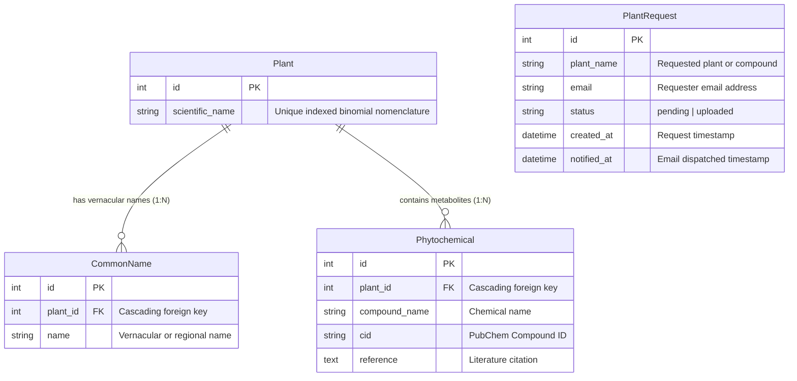

# BMPPD: Bangladeshi Medicinal Plant Phytochemicals Database (BMPPD)

[](https://bmppd.org/)
[](https://www.python.org/)
[](https://www.djangoproject.com/)
[](https://pubchem.ncbi.nlm.nih.gov/)

---

## Abstract

Natural products derived from medicinal flora represent a primary cornerstone of pharmacophore discovery and traditional healthcare systems. Despite Bangladesh's extensive botanical diversity and deep-rooted ethnopharmacological heritage, scientific exploration of these bioresources has historically suffered from fragmented literature, unstandardized vernacular taxonomies, and an absence of unified computational repositories. 

Here, we present the **Bangladeshi Medicinal Plant Phytochemicals Database (BMPPD)** ([https://bmppd.org](https://bmppd.org)), the first comprehensive, peer-curated, web-accessible cheminformatics and ethnobotanical database devoted to the medicinal plants of Bangladesh. Developed over two years of rigorous literature synthesis at **Dawnilab** (the research hub of *Dawn of Bioinformatics Limited Bangladesh*), BMPPD bridges ethnobotanical folk taxonomy with structured molecular cheminformatics. 

Currently, the operational database indexes **341 verified botanical species**, linked to **712 vernacular/common names**, **31,717 curated plant–metabolite associations**, **16,333 unique phytochemical entities**, and **10,302 cross-referenced PubChem Compound Identifiers (CIDs)**, with a cumulative data pipeline encompassing upwards of **700 medicinal taxa and >113,000 phytochemical entries**. Equipped with multi-tiered querying (scientific nomenclature, vernacular designations, compound designations, and PubChem CIDs), automated literature provenance tracing, and an interactive crowdsourced plant request tracking mechanism, BMPPD provides an open, high-performance foundation for secondary metabolite exploration, virtual screening, network pharmacology, and rational drug discovery.

---

## 1. Introduction

Phytochemical constituents from medicinal flora serve as critical lead scaffolds for synthetic chemistry, pharmaceutical development, and functional metabolomics. In South Asia, particularly Bangladesh, traditional medicine traditions (such as Ayurveda, Unani, and indigenous folk practices) rely heavily on regional flora. However, researchers, medicinal chemists, and pharmacologists encounter major obstacles during modern drug development pipelines:
1. **Literature Fragmentation:** Quantitative and qualitative phytochemical reports remain dispersed across disparate regional and international journals, monographs, and institutional dissertations.
2. **Nomenclature and Taxonomical Ambiguity:** A single plant species may carry dozens of regional vernacular names (in Bengali and tribal dialects) across different geographic divisions, while synonyms and outdated botanical nomenclature complicate compound cross-referencing.
3. **Cheminformatics Disconnect:** Published literature frequently identifies compound names without cross-linking to persistent international chemical identifiers (such as PubChem CIDs, SMILES, or InChIKeys), preventing computational workflows such as high-throughput virtual screening (HTVS) and ADMET profiling.

To overcome these bottlenecks, BMPPD was conceived, engineered, and deployed as a centralized digital infrastructure connecting botanical taxonomy, chemical structures, and peer-reviewed literature citations.

---

## 2. Materials, Data Curation & Pipeline

```
+---------------------------------------------------------------------------------+
|                        Literature Mining & Data Acquisition                     |
|    - Peer-reviewed journals, ethnobotanical surveys, PhD/MSc dissertations     |
|    - Extraction: Plant Taxa, Regional Names, Compound Names, Citations          |
+---------------------------------------------------------------------------------+
                                       │
                                       ▼
+---------------------------------------------------------------------------------+
|                         Standardization & Cheminformatics                       |
|    - Botanical Validation: Canonical Binomial Nomenclature                      |
|    - Vernacular Mapping: Bengali, English, and regional dialect synonyms        |
|    - Chemical Resolution: PubChem CID assignment & compound deduplication      |
+---------------------------------------------------------------------------------+
                                       │
                                       ▼
+---------------------------------------------------------------------------------+
|                        Relational Database Architecture                         |
|    - Normalized Django ORM Schema (Plant, CommonName, Phytochemical)            |
|    - Referential Integrity & Composite Uniqueness: (plant, compound, cid)      |
|    - Logging pipelines: import auditing, duplicate audits, and summary logs    |
+---------------------------------------------------------------------------------+
                                       │
                                       ▼
+---------------------------------------------------------------------------------+
|                       Web Application, Search & Services                        |
|    - Sub-second Multi-field Search Engine with ORM query prefetching            |
|    - User Feedback & Crowdsourced "Request Data" Modal Interface                |
|    - Admin & Staff Portal for request lifecycle management                      |
+---------------------------------------------------------------------------------+
```

### 2.1 Botanical and Chemical Standardization
Data collection followed a rigorous, multi-tiered manual curation protocol:
- **Taxonomical Resolution:** Botanical identities were reconciled against global taxonomic databases to verify canonical accepted binomial scientific names and rectify synonymy.
- **Vernacular Aggregation:** Local and colloquial plant designations were systematically captured to enable researchers without prior botanical taxonomic background to search seamlessly.
- **Chemical Structure Resolution:** Each reported compound underwent name-to-structure normalization and was cross-referenced with the **PubChem** database to retrieve corresponding PubChem CIDs.
- **Literature Provenance:** Every plant–phytochemical pair is linked to its underlying primary scientific literature reference.

### 2.2 Data Statistics (Ingested Core Repository)

| Dimension / Metric | Verified Count | Functional Role in Repository |
|:---|:---:|:---|
| **Botanical Taxa (`Plant`)** | **341** | Distinct validated medicinal plant species |
| **Vernacular Names (`CommonName`)** | **712** | Multilingual Bengali and English common names |
| **Plant–Compound Associations** | **31,717** | Documented occurrences of metabolites in specific plants |
| **Unique Phytochemical Compounds** | **16,333** | Unique compound names extracted from literature |
| **Distinct PubChem CIDs** | **10,302** | Unique persistent PubChem chemical identifiers |
| **Source Data Curations** | **350+ Files** | Individual curated species datasets |
| **Total Cumulative Project Scope** | **>700 Plants / ~113,400 Records** | Ongoing pipeline expansion curated across two years |

---

## 3. Database Schema & System Architecture

BMPPD is implemented using **Django 5.2 (Python 3.10+)** following Model-View-Template (MVT) principles and utilizing a normalized relational architecture.

### 3.1 Entity-Relationship Model



### 3.2 Key Architecture & Query Optimization Strategies
- **Indexed Search Resolution:** The search endpoint (`/bmppd_result/?q=...`) leverages a multi-field `Q` evaluation spanning `plant__scientific_name`, `plant__common_names__name`, `compound_name`, and `cid`.
- **Query Optimization (`N+1` Prevention):** Search queries execute via `select_related('plant')` alongside `prefetch_related(Prefetch('plant__common_names'))`, reducing database roundtrips to an asymptotic constant time $O(1)$ relative to record volume.
- **Query Safeguards:** A minimum query length threshold ($\ge 4$ characters) and result caps (800 records) prevent database exhaustion while sustaining sub-second execution speeds.
- **Asynchronous User Feedback:** When an inquiry yields zero records, the interface deploys an automated modal interface empowering the user to submit a `PlantRequest`. An alert is routed directly to editorial staff (`dawn.of.bioinformatics@gmail.com`), with staff-protected tracking and email notification triggers (`/manage-requests/`).

---

## 4. Web Interface & Core Capabilities

The live platform is deployed at [https://bmppd.org](https://bmppd.org) with the following modules:

1. **Intelligent Multi-Field Search:** Real-time lookup by scientific name (e.g., *Azadirachta indica*), common/Bengali name (e.g., *Neem*, *Nimgach*), compound name (e.g., *Azadirachtin*), or PubChem CID (e.g., *5281303*).
2. **Direct PubChem Interoperability:** Result sets generate dynamic hyperlinks into PubChem (`https://pubchem.ncbi.nlm.nih.gov/compound/<CID>`), enabling immediate access to 2D/3D conformers, SMILES, bioassays, and molecular properties.
3. **Reference Verification:** Literature citations for every plant-compound pairing are accessible via dedicated reference modals.
4. **Interactive Request Management System:** A curated staff dashboard enables project curators to view, edit, fulfill, and automatically dispatch email notifications to researchers once missing plant data has been uploaded.

---

## 5. Installation, Deployment & Local Setup

### 5.1 Prerequisites
- **Python:** 3.10, 3.11, or 3.12
- **Database Engine:** SQLite3 / PostgreSQL / MySQL
- **Git**

### 5.2 Environment Setup
```bash
# 1. Clone the repository
git clone https://github.com/Soash/BD-Plant-Phytochemicals-DB.git
cd BD-Plant-Phytochemicals-DB/project

# 2. Initialize and activate a virtual environment
python -m venv venv
# On Windows (PowerShell):
.\venv\Scripts\Activate.ps1
# On Unix/macOS:
source venv/bin/activate

# 3. Install dependencies
pip install django django-environ whitenoise
```

### 5.3 Configuration & Database Initialization
Create a `.env` file within the `project/` directory:
```ini
ENVIRONMENT=development
SECRET_KEY=your-secure-django-secret-key-here
DEBUG=True
```

Execute schema migrations and administrative setup:
```bash
# Apply migrations
python manage.py migrate

# Seed data from raw species CSV collections (if applicable)
python manage.py import_csvs

# Create superuser for access to the administration portal
python manage.py createsuperuser

# Launch the development server
python manage.py runserver
```
Visit `http://127.0.0.1:8000/` to explore the portal locally.

---

## 6. Project Team & Acknowledgements

The development and ongoing curation of the **Bangladeshi Medicinal Plant Phytochemicals Database (BMPPD)** has been made possible through the collective effort, leadership, and technical expertise of the team at **Dawn of Bioinformatics Limited Bangladesh** and **Dawnilab**.

### Project Leadership
- **Project Director:** [Sk. Faisal Ahmed](https://www.linkedin.com/in/skfaisalahmed/)
- **Project Manager:** [Amir Alve](https://www.linkedin.com/in/md-amir-alve/)
- **Deputy Project Managers:** 
  - [Imranur Rahman](https://www.linkedin.com/in/md-imranur-rahman-5508a0155/)
  - [Abir Hossain](https://www.linkedin.com/in/abir-hossain-702a941b3/)
  - [Shormila Akter Sumya](https://www.linkedin.com/in/shormila-akter-sumya-48794a210/)
  - [Md Shah Paran](https://www.linkedin.com/in/md-shah-paran-11970a300/)
- **Database Developer:** [Md Abu Sadat Soash](https://www.linkedin.com/in/soash-sadat/)

### Project Coordinators
Special gratitude is extended to the project coordinators and curation team:  
[Md Raihan Ahmed](https://www.linkedin.com/in/md-raihan-ahmed-b79b5b291), [Esha Mony Bristy](https://www.linkedin.com/in/eshamonybristy), [Kaniz Fatema](https://www.linkedin.com/in/kaniz-fatema-chhowa-4a0465217), [Md Asif Siddque Jim](https://www.linkedin.com/in/asifsiddque/), Zannatul Firdaus, [Rafa Uddin](https://www.linkedin.com/in/rafa-udd-in), [Md Tajul Islam](https://www.linkedin.com/in/md-tajul-islam-06ab38372), [Taiyara Mahjabin](https://www.linkedin.com/in/taiyara-mahjabin-243727209), [Md Ismail Hossain](https://www.linkedin.com/in/md-ismail-hossain-bb2aa1179), [Rakibul Hasan Alif](https://www.linkedin.com/in/rakibul-hasan-alif-8a5362265), [Md Aftabur Rahman](https://www.linkedin.com/in/md-aftabur-rahman-aftab-6b218235b), [Rahat Moinul Islam](https://www.linkedin.com/in/rahatmoinulislam/), [Foysal Ahmed](https://www.linkedin.com/in/foysal-ahmed-joy-100708268), [Mst. Marjeya](https://www.linkedin.com/in/mst-marjeya), [Mst. Afrin Mustari](https://www.linkedin.com/in/afrinmustarii), [Md Ashrarul Hasib](https://www.linkedin.com/in/md-ashrarul-hasib-721543312), [Md Sadique Hossain](https://www.linkedin.com/in/md-sadique-hossain-5368563a8), [Nishat Ulfat Nity](https://www.linkedin.com/in/nishat-ulfat-nity-a5679229b), [Md Foisal Imtiaz](https://www.linkedin.com/in/md-foisal-imtiaz-8b48b6285), [Ovejan Paul Rudra](https://www.linkedin.com/in/ovejan-paul-rudra-6901ba23a/), [Asifuzzaman Zisan](https://www.linkedin.com/in/asifuzzaman-zisan-3ab8a9283), [Md Delwar Hossen](https://www.linkedin.com/in/mddelwarhossen10), [Tania Akter Nirjona](https://www.linkedin.com/in/nirjona-tania-b7262), and [Prami Chowdhury Badhan](https://www.linkedin.com/in/badhan-chowdhury-328785321).

---

## 7. Citation

If you utilize BMPPD data, chemical mappings, or architecture in your scientific investigations, academic dissertations, or computational drug screening publications, please cite the database as follows:

```bibtex
@article{BMPPD2026,
  title   = {BMPPD: Bangladeshi Medicinal Plant Phytochemicals Database},
  author  = {Ahmed, Sk. Faisal and Alve, Amir and Rahman, Imranur and Hossain, Abir and Sumya, Shormila Akter and Paran, Md Shah and Soash, Md Abu Sadat and {BMPPD Consortium}},
  journal = {Dawn of Bioinformatics Limited Bangladesh},
  year    = {2026},
  url     = {https://bmppd.org/}
}
```

---

## 8. Inquiries & Correspondence
- **Principal Platform:** [https://bmppd.org](https://bmppd.org)
- **Organization:** [Dawn of Bioinformatics Limited Bangladesh](https://dawnofbioinformatics.com/)
- **Scientific Correspondence & Plant Ingestion Requests:** [dawn.of.bioinformatics@gmail.com](mailto:dawn.of.bioinformatics@gmail.com)
